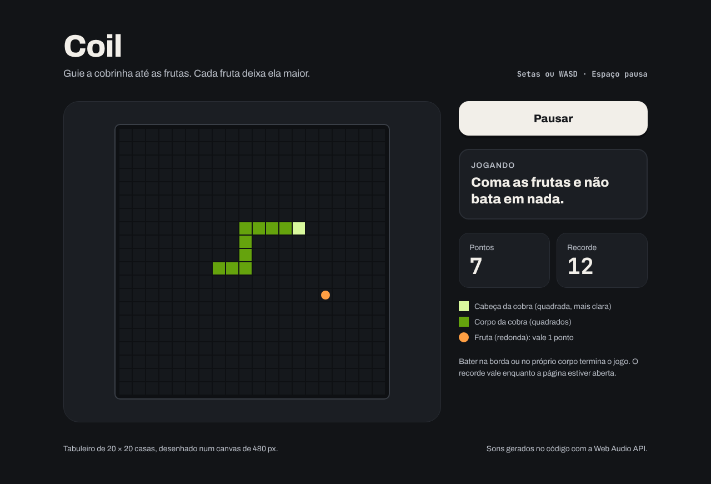

# Coil

Jogo da cobrinha numa grade de 20 × 20 casas, desenhado num canvas e movido por um game loop. Projeto de aula da Fase 2 (JavaScript puro).

**Deploy:** https://coil-renanferreira-dev.vercel.app

## Como rodar

Baixe ou clone o repositório e abra o `index.html` no navegador. Não precisa instalar nada.

Controles: setas ou WASD para mover, Espaço para pausar.

## Etapas

Projeto de aula: cada etapa é um commit na `main`. Use `git log --oneline` para ver a lista e `git checkout <hash>` para abrir o projeto como ele estava naquela etapa (`git switch main` volta para a versão final).

| Etapa | Conceito |
|---|---|
| `00-ponto-de-partida` | Projeto vazio: README, .gitignore, LICENSE e index.html |
| `01-pagina-em-html-e-css` | A página do design, sem JavaScript, com o `<canvas>` vazio |
| `02-desenhando-no-canvas` | `getContext('2d')`, `fillStyle` e `fillRect`, em pixels a partir do canto de cima à esquerda |
| `03-coordenadas-da-grade` | Casa x pixel: a cobra é um array de `{ x, y }` em casas |
| `04-movendo-a-cobra` | `unshift` da cabeça nova e `pop` da cauda, um passo por clique |
| `05-game-loop` | `requestAnimationFrame` chamando a si mesmo (e a cobra rápida demais) |
| `06-controlando-a-velocidade` | O `timestamp` do quadro: um passo a cada 125 ms |
| `07-mudando-de-direcao` | `keydown`, um objeto de direções e `preventDefault` |
| `08-fruta-na-grade` | `Math.random()`, `some()` para achar casa livre e `arc` para a fruta redonda |
| `09-comendo-a-fruta` | Colisão é comparar coordenadas: a cobra cresce e soma ponto |
| `10-batendo-na-borda` | Colisão com a parede, `cancelAnimationFrame` e "Jogar de novo" |
| `11-batendo-em-si-mesma` | `isOnSnake` reaproveitada (e a meia-volta que mata) |
| `12-sem-meia-volta` | Ignorar a direção oposta e guardar a próxima direção |
| `13-recorde-da-sessao` | `Math.max` no fim de jogo |
| `14-pausa` | Uma variável de fase e o Espaço pausando o loop |
| `15-sons-com-web-audio` | Som ao comer e ao perder, com a Web Audio API |

## Pontos de atenção

### Onde costuma travar

- `01-pagina-em-html-e-css`: o tamanho do desenho vem dos atributos `width` e `height` do `<canvas>`. Mudar a largura só pelo CSS estica a imagem, e tudo fica borrado.
- `01-pagina-em-html-e-css`: para o leitor de tela, o canvas é só uma imagem. Por isso ele tem `role="img"` e `aria-label`, e pontos e mensagens ficam em texto fora dele.
- `02-desenhando-no-canvas`: o `(0, 0)` é o canto de cima à esquerda, e o `y` cresce para baixo, ao contrário do gráfico da escola.
- `02-desenhando-no-canvas`: o `fillStyle` vale para tudo que vier depois, até ser trocado. Esquecer de trocar pinta o próximo desenho com a cor anterior.
- `03-coordenadas-da-grade`: a cobra guarda casas, não pixels. A conta `x * cellSize` só acontece na hora de desenhar.
- `04-movendo-a-cobra`: a cobra não "anda": a cada passo nasce uma cabeça na frente (`unshift`) e a ponta da cauda some (`pop`).
- `05-game-loop`: `requestAnimationFrame(gameLoop)` passa a função, sem parênteses. Com `gameLoop()`, ela roda na hora e chama a si mesma sem parar, até o erro `Maximum call stack size exceeded`.
- `05-game-loop`: o loop roda a cada quadro, uns 60 por segundo (mais, em monitores de 120 ou 144 Hz). Sem controlar o tempo, a cobra some da tela em menos de um segundo.
- `06-controlando-a-velocidade`: o `timestamp` é a hora do quadro em milissegundos, não um contador de quadros. Comparar com a hora do último passo deixa a velocidade igual em qualquer monitor.
- `07-mudando-de-direcao`: as setas rolam a página. Sem `event.preventDefault()`, a página desce junto com a cobra.
- `07-mudando-de-direcao`: o `event.key` das setas é `"ArrowUp"`; com `toLowerCase()`, vira `"arrowup"`, que é a chave do objeto `directions`.
- `08-fruta-na-grade`: `arc` só desenha o contorno do caminho; quem pinta é o `fill()`. Sem o `beginPath()`, os círculos de antes entram no caminho de novo.
- `08-fruta-na-grade`: a fruta pode ser sorteada em cima da cobra. O `while` sorteia de novo até cair numa casa livre.
- `09-comendo-a-fruta`: comparar `head === food` dá sempre `false`, porque são dois objetos diferentes. A colisão compara o `x` e o `y`.
- `10-batendo-na-borda`: o `requestAnimationFrame` é pedido no começo do loop. Pedido no fim, ele seria agendado depois do `cancelAnimationFrame`, e o jogo não pararia.
- `10-batendo-na-borda`: a borda direita é a casa `19`, não a `20`: as casas vão de `0` a `gridSize - 1`.
- `11-batendo-em-si-mesma`: a mesma `isOnSnake` que procura casa livre para a fruta descobre se a cabeça caiu no corpo.
- `12-sem-meia-volta`: só ignorar a seta contrária não basta. Duas teclas rápidas no mesmo passo (para cima e para a esquerda, indo para a direita) fariam a meia-volta. Por isso a direção pedida espera o próximo passo em `nextDirection`.
- `14-pausa`: o Espaço também aperta o botão em foco. Sem `preventDefault()`, um aperto pausaria e continuaria ao mesmo tempo.
- `15-sons-com-web-audio`: o `AudioContext` nasce no clique em Começar. Criado ao comer a primeira fruta, ele nasceria fora de um clique e poderia ficar mudo.

### O que eu faria diferente

- A cobra morre ao entrar na casa em que a cauda está saindo. Muitos jogos deixam passar, porque a cauda sai no mesmo passo; aqui ficou a regra mais simples.
- A pausa existe, mas a página não pausa sozinha quando a aba fica escondida. O `requestAnimationFrame` para nessa hora, e ao voltar a cobra dá um passo na hora.
- A velocidade é fixa. Acelerar a cada fruta seria o próximo desafio, mexendo só no `stepDelay`.
- O movimento da cobra é o próprio jogo e não há animação decorativa, então o `prefers-reduced-motion` não tem o que reduzir aqui.
- A página foi pensada para telas de 1280 px e para teclado. Uma versão para celular precisaria de botões de direção na tela.

## Navegadores

Canvas 2D, `requestAnimationFrame` e Web Audio API funcionam em todos os navegadores atuais.

## Créditos

- Sons gerados no código com a Web Audio API, sem arquivos de áudio.
- Fontes [Archivo](https://fonts.google.com/specimen/Archivo) e [JetBrains Mono](https://fonts.google.com/specimen/JetBrains+Mono), do Google Fonts, sob a licença SIL Open Font License.
- Código sob licença MIT.
